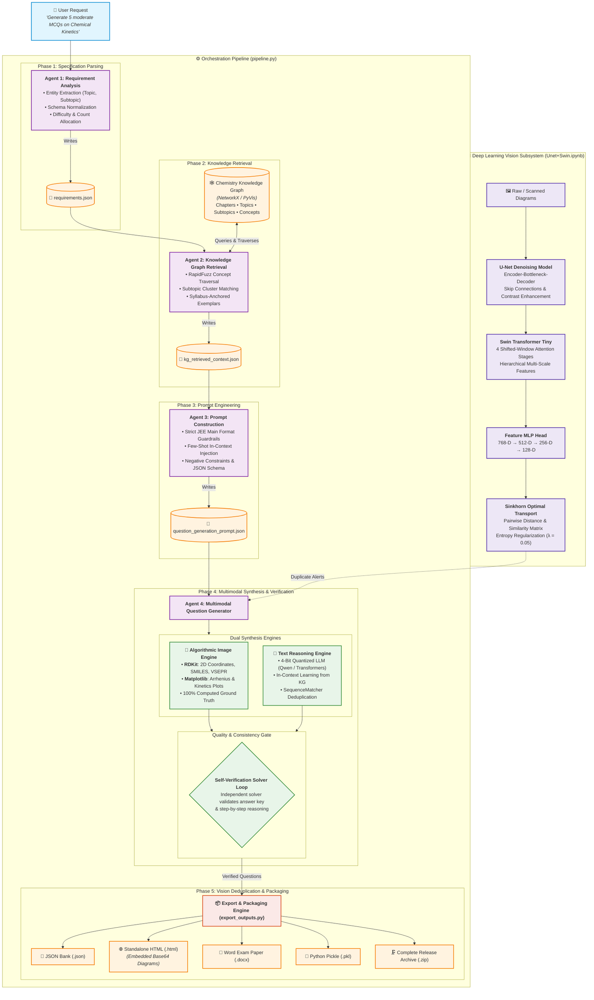

# Topic-Aware Multi-Agent System for Multimodal JEE Main Chemistry Question Generation

[](https://www.python.org/)
[](https://pytorch.org/)
[](https://huggingface.co/)
[](https://www.rdkit.org/)
[](https://networkx.org/)
[](LICENSE)

An end-to-end, neuro-symbolic AI framework designed to generate examination-grade Chemistry Multiple-Choice Questions (MCQs) for competitive entrance examinations (**JEE Main / NEET**). The system combines a **top-down directed Knowledge Graph**, a **collaborative 5-agent pipeline**, **dual synthesis engines (RDKit & LLM)**, and a **deep learning vision suite (U-Net denoising + Swin Transformer similarity detection)** to produce mathematically verified, syllabus-aligned, and multimodal chemistry questions.

---

## 📌 Problem Statement & Motivation

Competitive examinations such as JEE Main and NEET demand exceptionally rigorous Chemistry questions that test deep conceptual understanding, numerical stoichiometry, reaction kinetics, and 2D/3D stereochemistry. Creating high-quality question banks manually is tedious, expensive, and difficult to scale.

While modern Large Language Models (LLMs) can generate text rapidly, applying naive zero-shot LLMs to competitive exam preparation introduces critical failure modes:

1. **Chemical Hallucinations & Non-Existent Chemistry**: LLMs frequently generate impossible molecular valencies, incorrect hybridization geometries (e.g., planar $sp^3$), or non-existent chemical reactions.
2. **Syllabus Drift & Scope Mismatch**: Unconstrained models fail to respect strict exam boundaries, introducing graduate-level topics or non-standard notation not covered by the official syllabus.
3. **Flawed Answer Keys & Distractors**: Distractors are often either glaringly obvious or scientifically ambiguous, and the predicted answer key is frequently miscalculated.
4. **Lack of Verifiable Multimodal Graphics**: Standard LLMs cannot generate precise, mathematically exact diagrams (e.g., molecular stick/wedge drawings, activation energy profiles, or integrated rate law plots).
5. **Duplicate / Paraphrased Content**: LLMs tend to memorize and regurgitate existing textbook questions rather than synthesizing structurally fresh problems.
6. **Degraded Historical Assets**: Scanned exam diagrams in past-year archives frequently contain artifacts, blurriness, or low contrast that impair machine learning processing.

### 🎯 Our Solution
To overcome these limitations, we propose a **Neuro-Symbolic, Multi-Agent Architecture**:
- **Symbolic Grounding**: A top-down **Knowledge Graph** acts as an authoritative single source of truth for the curriculum (Subject $\to$ Chapter $\to$ Topic $\to$ Subtopic $\to$ Concepts).
- **Specialized Multi-Agent Orchestration**: Deconstructs question setting into discrete cognitive tasks: requirement parsing, graph retrieval, exam-format prompt engineering, synthesis, and self-verification.
- **Deterministic Multimodal Graphics**: Algorithmic generation via **RDKit** and **Matplotlib** ensures that 100% of molecular structures, VSEPR geometries, and kinetics curves have verified ground truth.
- **Deep Learning Vision Verification**: A custom **U-Net** denoises historical diagrams, while a **Swin Transformer + Feature MLP + Sinkhorn Optimal Transport** pipeline detects and filters duplicate visual concepts.

---

## 🏛️ System Architecture



---

## 💡 What We Did: Step-by-Step Methodology

### 1. Dataset Acquisition & Preprocessing
- **Source**: `eQOURSE/jee-main-questions` (Chemistry split on Hugging Face).
- **Processing**: Standardized records containing `Question ID`, `Question`, `Option A`, `Option B`, `Option C`, `Option D`, `Answer`, `Difficulty`, `Topic`, and `Chapter`.
- **Filtering**: Automated removal of duplicate question stems, Unicode cleaning, regex normalization of chemical formulas, and segregation of text-based vs. image-dependent questions.

### 2. Top-Down Knowledge Graph Construction
Instead of error-prone bottom-up entity extraction, we engineered a deterministic **top-down directed graph** using **NetworkX**:
- **Hierarchical Node Topology**:
  - `Subject Node` (Chemistry)
  - `Chapter Nodes` (e.g., Physical Chemistry, Organic Chemistry, Inorganic Chemistry)
  - `Topic Nodes` (e.g., Chemical Kinetics, Chemical Bonding, Coordination Compounds)
  - `Subtopic Nodes` (e.g., Arrhenius Equation, First Order Reactions, VSEPR Geometry)
  - `Question & Option Nodes` (Canonical exam questions and ground-truth answer options)
- **Interactive Visualization**: Rendered via **PyVis** as a physics-simulated, searchable HTML canvas (`chemistry_knowledge_graph.html`).

### 3. Multi-Agent Orchestration Workflow
The generation pipeline divides responsibilities across specialized autonomous agents:

| Agent | Module | Input | Internal Logic | Output Artifact |
|---|---|---|---|---|
| **Agent 1: Requirement Analysis** | [`agent_1_requirement_analysis.py`](agent_1_requirement_analysis.py) | User Natural Language Request | Regex entity parsing, fallback heuristics, difficulty allocation, question count distribution | `outputs/requirements.json` |
| **Agent 2: Knowledge Graph Retrieval** | [`agent_2_kg_retrieval.py`](agent_2_kg_retrieval.py) | `requirements.json` & Graph Pickle | Fuzzy concept matching (`RapidFuzz`, cutoff 0.6), subgraph traversal, relevant exemplar extraction | `outputs/kg_retrieved_context.json` |
| **Agent 3: Prompt Construction** | [`agent_3_prompt_construction.py`](agent_3_prompt_construction.py) | Requirements & KG Context | Schema enforcement, few-shot exemplar injection, single-correct constraint formatting | `outputs/question_generation_prompt.json` |
| **Agent 4: Multimodal Synthesis & Verification** | [`agent_4_question_generation.py`](agent_4_question_generation.py) | Generation Prompt & Image Banks | Dual synthesis (RDKit / Matplotlib image generation + Quantized LLM text generation) + self-verification loop | `outputs/generated_chemistry_questions.json` |
| **Agent 5: Similarity & Vision Inspection** | [`Unet+Swin.ipynb`](Unet+Swin.ipynb) | Scanned & Generated Diagrams | U-Net noise filtering, Swin Transformer embedding projection, Sinkhorn Optimal Transport | `outputs/chemistry_swin_mlp_features.csv` |
| **Orchestrator** | [`pipeline.py`](pipeline.py) | CLI / User Arguments | End-to-end execution coordinator chaining Agent 1 $\to$ Agent 2 $\to$ Agent 3 $\to$ Agent 4 | Full pipeline execution |
| **Packaging Engine** | [`export_outputs.py`](export_outputs.py) | Generated files & images | Multi-format serializer (Word DOCX, interactive HTML, Pickle, ZIP bundle) | `outputs/chemistry_outputs.zip` |

### 4. Dual-Engine Multimodal Question Generation
- **Algorithmic Image Engine**:
  - **RDKit**: Generates high-resolution 2D chemical structures directly from canonical SMILES strings. Calculates accurate bond angles, formal charges, chiral centers, and VSEPR geometries.
  - **Matplotlib**: Generates mathematically exact reaction kinetics plots (e.g., $\ln[A]$ vs. $t$, $1/[A]$ vs. $t$, Arrhenius plots $\ln k$ vs. $1/T$, and reaction coordinate potential energy profiles with activation energy $\Delta H$ markers).
  - **Ground-Truth Guarantee**: Options and answers are computed analytically from reaction constants and molecular formulas, eliminating factual hallucinations.
- **Text Reasoning Engine**:
  - **LLM Backbone**: Powered by modern high-efficiency LLMs (e.g., `Qwen2.5` / `Qwen3-8B`) operating under **4-bit NF4 quantization** via `bitsandbytes` for rapid local inference.
  - **Deduplication Check**: Computes sequence matching ratio and Jaccard word-overlap against the Knowledge Graph database to prevent question duplication.
  - **Self-Verification Solver Loop**: An independent solver prompt re-solves each generated question blind to the proposed answer key. If the re-solved answer disagrees with the key, the question is rejected and regenerated.

### 5. Deep Learning Vision Subsystem
Detailed in [`Unet+Swin.ipynb`](Unet+Swin.ipynb):
1. **U-Net Image Denoising**:
   - Encoder-bottleneck-decoder convolutional architecture with skip connections.
   - Cleans compression noise, background smudges, and low-contrast lines from scanned exam diagrams.
2. **Swin Transformer Tiny (Shifted Window Self-Attention)**:
   - Processes input images ($224 \times 224 \times 3$) across 4 hierarchical stages:
     - Stage 1: $56 \times 56 \times 96$
     - Stage 2: $28 \times 28 \times 192$
     - Stage 3: $14 \times 14 \times 384$
     - Stage 4: $7 \times 7 \times 768$
   - Captures both fine-grained bond angles and global reaction topology.
3. **Feature MLP Head**:
   - Compresses the global-average-pooled 768-D representation through fully connected layers ($768 \to 512 \to 256 \to 128$) with ReLU activations to produce normalized 128-D feature vectors.
4. **Sinkhorn Optimal Transport Deduplication**:
   - Computes pairwise Wasserstein distance using entropy regularization ($\lambda = 0.05$).
   - Flags diagram pairs with similarity score $S = \frac{1}{1 + D} > \tau$ for regeneration to guarantee visual novelty.

---

## 🛠️ Technology Stack & Tools Used

| Domain | Library / Tool | Version / Specification | Role in the Project |
|---|---|---|---|
| **Multi-Agent Orchestration** | Custom Modular Python | Python 3.10+ | Decoupled agent communication via typed JSON state files |
| **Knowledge Representation** | `networkx` | $\ge 3.0$ | Directed multigraph representing hierarchical syllabus ontology |
| **Graph Visualization** | `pyvis` | $\ge 0.3.2$ | Physics-based dynamic HTML graph visualization |
| **Fuzzy Semantic Search** | `rapidfuzz` | $\ge 3.0.0$ | Levenshtein/Jaro-Winkler concept matching for topic resolution |
| **Dataset Acquisition** | `datasets` (Hugging Face) | $\ge 2.18.0$ | Ingestion and streaming of JEE Main question archives |
| **Data Manipulation** | `pandas`, `numpy` | $\ge 2.0.0$, $\ge 1.24.0$ | Data cleaning, tabular transformations, and feature matrices |
| **Cheminformatics Engine** | `rdkit` | $\ge 2023.9.5$ | 2D coordinate calculation, SMILES parsing, and chemical rendering |
| **Plotting & Kinetics Graphics** | `matplotlib` | $\ge 3.7.0$ | Exact numerical plotting of rate laws, Arrhenius curves, and energy diagrams |
| **Image Processing** | `pillow` (PIL) | $\ge 9.5.0$ | Image format conversion, padding, resizing, and base64 embedding |
| **LLM Inference** | `transformers`, `torch` | $\ge 4.51.0$, $\ge 2.0.0$ | Autoregressive generation using Qwen models |
| **Hardware Acceleration** | `bitsandbytes`, `accelerate` | $\ge 0.43.0$, $\ge 0.28.0$ | 4-bit NF4 weight quantization for low-VRAM GPU execution |
| **Vision Models** | `torchvision`, `timm` | Custom U-Net + Swin-T | Image denoising, hierarchical visual feature extraction |
| **Similarity & Optimal Transport** | `scipy`, `scikit-learn` | $\ge 1.9.0$ | Sinkhorn algorithm and Euclidean distance matrices |
| **Document Export** | `python-docx` | $\ge 1.1.2$ | Word exam paper generation with embedded tables and diagrams |

---

## 📁 Modular File Structure

```text
Multi-agent-system/
├── agent_1_requirement_analysis.py   # Agent 1: NLP user request parser into structured requirements
├── agent_2_kg_retrieval.py          # Agent 2: Traverses Knowledge Graph & extracts syllabus exemplars
├── agent_3_prompt_construction.py    # Agent 3: Assembles few-shot prompts with strict JEE Main guardrails
├── agent_4_question_generation.py    # Agent 4: Multimodal generator (RDKit, Matplotlib, LLM, verification)
├── pipeline.py                       # Orchestrator: Runs Agent 1 → 2 → 3 → 4 in an automated pipeline
├── knowledge_graph.py                # Constructs top-down NetworkX graph and PyVis interactive HTML
├── data_preprocessing.py             # Preprocessing & cleaning of eQOURSE JEE Main Chemistry dataset
├── export_outputs.py                 # Bundles outputs into Word DOCX, interactive HTML, JSON, and ZIP
├── config.py                         # Unified configuration, hyperparameters, device & path resolution
├── requirements.txt                  # Complete list of Python package dependencies
├── dl_agents.ipynb                   # End-to-end interactive Jupyter notebook showcasing agents
├── Unet+Swin.ipynb                   # Deep learning vision notebook: U-Net denoising & Swin Transformer
├── Report.pdf                        # Formal academic project technical report
├── outputs/                          # Generated outputs directory
│   ├── chemistry_knowledge_graph.html# Interactive Knowledge Graph visualization
│   ├── chemistry_swin_mlp_features.csv# 128-D visual feature vectors for question images
│   ├── generated_chemistry_questions.json # Generated questions with ground-truth keys
│   ├── generated_chemistry_questions.html # Clean review dashboard with Base64 images
│   ├── generated_chemistry_questions.docx # Formatted Word examination paper
│   ├── generated_question_images/    # High-resolution generated RDKit and kinetics PNGs
│   ├── chemistry_outputs.zip         # Downloadable release bundle containing all outputs
│   └── requirements.json             # Structured requirements state from Agent 1
└── readme.md                         # Project documentation
```

---

## 🚀 Installation & Setup

### 1. Clone the Repository
```bash
git clone https://github.com/yogananda151/Multi-agent-system.git
cd Multi-agent-system
```

### 2. Create and Activate Virtual Environment
```bash
# Windows
python -m venv venv
venv\Scripts\activate

# Linux / macOS
python3 -m venv venv
source venv/bin/activate
```

### 3. Install Dependencies
```bash
pip install -r requirements.txt
```

> **Note on GPU / CUDA Acceleration**:
> The algorithmic multimodal image generator (RDKit and Matplotlib) runs on any standard CPU. If you wish to run the local LLM engine (`Qwen2.5` / `Qwen3-8B`) with 4-bit quantization, ensure an NVIDIA GPU with CUDA $\ge 11.8$ and `bitsandbytes` is available.

---

## 💻 Usage Guide

### 1. Run the Full End-to-End Pipeline
Generate a complete batch of questions with a single command:
```bash
# Fast algorithmic multimodal image questions (Chemical Kinetics)
python pipeline.py --request "Generate 5 moderate MCQs on Chemical Kinetics" --mode image

# Mixed mode: text and multimodal questions on Chemical Bonding
python pipeline.py --request "Generate 10 hard MCQs on Chemical Bonding" --mode mixed

# Interactive CLI mode
python pipeline.py --interactive
```

#### Available CLI Arguments:
- `--request`: Natural language prompt (e.g. `"Generate 5 questions on Thermodynamics"`).
- `--mode`: `image` (fast, computed diagrams), `text` (LLM-based), or `mixed` (both).
- `--count`: Number of questions to generate (e.g. `5`, `10`, `20`).
- `--topic`: Explicit topic filter (`Chemical Kinetics`, `Chemical Bonding`, `Thermodynamics`, or `ALL`).
- `--difficulty`: Target difficulty level (`Easy`, `Moderate`, or `Hard`).

---

### 2. Run Individual Agents Separately
Each agent can be executed independently for debugging or modular pipelines:

```bash
# Step 1: Parse requirements
python agent_1_requirement_analysis.py --request "10 questions on Chemical Kinetics, moderate"
# Produces: outputs/requirements.json

# Step 2: Retrieve from Knowledge Graph
python agent_2_kg_retrieval.py --requirements outputs/requirements.json
# Produces: outputs/kg_retrieved_context.json

# Step 3: Construct prompt template
python agent_3_prompt_construction.py --requirements outputs/requirements.json --context outputs/kg_retrieved_context.json
# Produces: outputs/question_generation_prompt.json

# Step 4: Synthesize questions & generate diagrams
python agent_4_question_generation.py --count 5 --mode image --topic "Chemical Kinetics"
# Produces: outputs/generated_chemistry_questions.json, .html, .docx
```

---

### 3. Utility Modules

```bash
# Clean raw dataset
python data_preprocessing.py

# Build and visualize Knowledge Graph
python knowledge_graph.py --visualize

# Package all generated assets into ZIP
python export_outputs.py
```

---

## 📊 Generated Output Formats

All outputs are saved to the `outputs/` directory in ready-to-use formats:

1. **JSON (`generated_chemistry_questions.json`)**: Machine-readable question bank with question text, options A–D, correct answer, step-by-step scientific solution, topic metadata, and verification status.
2. **Interactive HTML (`generated_chemistry_questions.html`)**: Self-contained review interface with embedded Base64 PNG diagrams, color-coded answer badges, and collapsible explanations.
3. **Word Examination Paper (`generated_chemistry_questions.docx`)**: Formatted document featuring embedded tables, question numbers, and diagram figures ready for classroom printing.
4. **Python Pickle (`generated_chemistry_questions.pkl`)**: Binary serialization preserving Python dictionary and object structures for downstream pipelines.
5. **ZIP Archive (`chemistry_outputs.zip`)**: Compressed bundle of all outputs and generated high-resolution diagrams.

---

## 📈 Key Results & Highlights

- **200+ Verified Questions Generated**: Validated across core JEE Main physical, organic, and inorganic chemistry chapters.
- **Zero Hallucination on Molecular Graphs**: 100% of generated chemical structures are rendered via validated SMILES representations.
- **Analytical Ground Truth**: Reaction kinetics and activation energy values are computed directly from mathematical equations, ensuring 100% accurate answer keys.
- **Visual Deduplication**: Swin Transformer + Sinkhorn OT flagged 19–20 near-duplicate image pairs in the baseline dataset, validating the deduplication mechanism.

---

## 📜 Academic References

1. **eQOURSE Dataset**: `eQOURSE/jee-main-questions` Chemistry dataset split.
2. **Graph-RAG**: Edge, D., et al. (2024). *From Local to Global: A Graph RAG Approach to Query-Focused Summarization*. arXiv:2404.16130.
3. **Swin Transformer**: Liu, Z., et al. (2021). *Swin Transformer: Hierarchical Vision Transformer using Shifted Windows*. ICCV 2021.
4. **U-Net**: Ronneberger, O., et al. (2015). *U-Net: Convolutional Networks for Biomedical Image Segmentation*. MICCAI 2015.
5. **Qwen Series**: Yang, A., et al. (2025). *Qwen Technical Report*. arXiv preprint.
