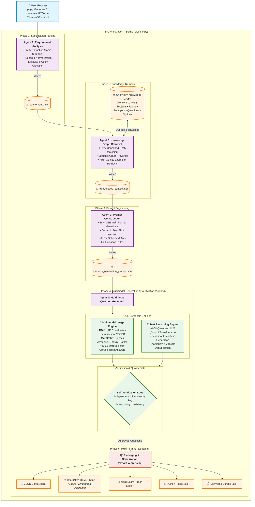

# Multimodal Chemistry Question Generation System (JEE Main)

An automated multi-agent AI system for generating examination-grade Chemistry questions with multimodal diagrams (molecular structures and reaction kinetics graphs) and verified answer keys.

---

## 🏛️ System Architecture

The system utilizes an autonomous multi-agent pipeline designed to parse natural language user specifications, retrieve syllabus-grounded context from a Chemistry Knowledge Graph, construct constraint-adherent prompts, and synthesize examination-grade questions featuring both algorithmic multimodal graphics and LLM-verified textual reasoning.



### 🔄 Multi-Agent Data Contract & Workflow

| Stage | Responsible Agent / Module | Inputs | Core Operations & Intelligence | Output Artifact |
|---|---|---|---|---|
| **1. Requirements** | [`agent_1_requirement_analysis.py`](file:///d:/Yoga/DL/D12/agent_1_requirement_analysis.py) | Raw user prompt | Regex entity parsing, fallback heuristics, count allocation, difficulty mapping | `outputs/requirements.json` |
| **2. Context Retrieval** | [`agent_2_kg_retrieval.py`](file:///d:/Yoga/DL/D12/agent_2_kg_retrieval.py) | Requirements JSON, `chemistry_knowledge_graph.pkl` | NetworkX bidirectional graph traversal, fuzzy string matching (cutoff 0.6), exemplar question extraction | `outputs/kg_retrieved_context.json` |
| **3. Prompt Construction** | [`agent_3_prompt_construction.py`](file:///d:/Yoga/DL/D12/agent_3_prompt_construction.py) | Requirements & Retrieved Context | In-context few-shot assembly, strict single-correct constraint formatting, anti-leakage guards | `outputs/question_generation_prompt.json` |
| **4. Generation & Verification** | [`agent_4_question_generation.py`](file:///d:/Yoga/DL/D12/agent_4_question_generation.py) | Generation Prompt & Image Banks | • **Image Engine**: Computes exact chemical coordinates with RDKit and plots kinetics curves with Matplotlib.<br/>• **Text Engine**: Generates novel questions via LLM.<br/>• **Verification Loop**: Independent solver re-evaluates correctness; rejects flawed distractors. | `outputs/generated_chemistry_questions.json` |
| **5. Packaging** | [`export_outputs.py`](file:///d:/Yoga/DL/D12/export_outputs.py) | Generated artifacts & image directories | Formats standalone HTML with embedded base64 figures, renders styled Word tables, and zips complete release bundle | `outputs/chemistry_outputs.zip` |

---

## 📁 Modular File Structure

| File | Component | Description |
|---|---|---|
| [`config.py`](file:///d:/Yoga/DL/D12/config.py) | **Configuration** | Unified paths, hyperparameters, device auto-detection (`cuda`/`cpu`), and memory helpers. |
| [`data_preprocessing.py`](file:///d:/Yoga/DL/D12/data_preprocessing.py) | **Data Preprocessing** | Cleans raw dataset (`eQOURSE/jee-main-questions`), filters text-only entries, removes duplicates, preserves IDs. |
| [`knowledge_graph.py`](file:///d:/Yoga/DL/D12/knowledge_graph.py) | **Knowledge Graph** | Builds NetworkX directed graph linking Subjects, Topics, Subtopics, Questions, Options, and Images. Creates interactive PyVis HTML visualization. |
| [`agent_1_requirement_analysis.py`](file:///d:/Yoga/DL/D12/agent_1_requirement_analysis.py) | **Agent 1** | Parses natural language user requests into structured requirements (Topic, Question Type, Count, Difficulty). |
| [`agent_2_kg_retrieval.py`](file:///d:/Yoga/DL/D12/agent_2_kg_retrieval.py) | **Agent 2** | Traverses Knowledge Graph with fuzzy matching to extract relevant concepts, options, images, and reference questions. |
| [`agent_3_prompt_construction.py`](file:///d:/Yoga/DL/D12/agent_3_prompt_construction.py) | **Agent 3** | Constructs structured prompt templates with domain rules, few-shot reference examples, and JSON schema constraints. |
| [`agent_4_question_generation.py`](file:///d:/Yoga/DL/D12/agent_4_question_generation.py) | **Agent 4** | Multimodal generator: RDKit molecule bank calculations, Matplotlib kinetics graphs, LLM generation, self-verification, and exports. |
| [`pipeline.py`](file:///d:/Yoga/DL/D12/pipeline.py) | **Orchestrator** | End-to-end runner that executes Agent 1 → Agent 2 → Agent 3 → Agent 4 seamlessly. |
| [`export_outputs.py`](file:///d:/Yoga/DL/D12/export_outputs.py) | **Packaging** | Bundles all outputs and images into a clean zip archive (`chemistry_outputs.zip`). |
| [`requirements.txt`](file:///d:/Yoga/DL/D12/requirements.txt) | **Dependencies** | Python package dependencies. |

---

## 🚀 Installation & Setup

1. **Install dependencies:**
   ```bash
   pip install -r requirements.txt
   ```

2. **(Optional) GPU / CUDA:**
   If running LLM text generation with 4-bit quantization, ensure a CUDA GPU is available with `bitsandbytes`. Image question generation via RDKit and Matplotlib runs anywhere without GPU.

---

## 💻 Usage Guide

### 1. Run the Full End-to-End Pipeline
Run the multi-agent pipeline with a single command:
```bash
python pipeline.py --request "Generate 5 moderate MCQs on Chemical Kinetics" --mode image
```
Or interactively:
```bash
python pipeline.py --interactive
```

Options:
- `--request`: Natural language prompt
- `--mode`: `image` (fast, computed), `text` (LLM-based), or `mixed` (both)
- `--count`: Number of questions (e.g. `5`, `10`, `20`)
- `--topic`: Topic override (e.g. `Thermodynamics`, `Chemical Bonding`, `ALL`)
- `--difficulty`: `Easy`, `Moderate`, or `Hard`

---

### 2. Run Individual Agents Separately

#### **Agent 1: Requirement Analysis**
Extracts structured requirements:
```bash
python agent_1_requirement_analysis.py --request "Please generate 10 hard MCQs on Chemical Bonding"
```
*Output: `outputs/requirements.json`*

#### **Agent 2: Knowledge Graph Retrieval**
Retrieves context based on Agent 1 requirements:
```bash
python agent_2_kg_retrieval.py --requirements outputs/requirements.json
```
*Output: `outputs/kg_retrieved_context.json` & `outputs/kg_retrieved_context.pkl`*

#### **Agent 3: Prompt Construction**
Builds structured generation prompts:
```bash
python agent_3_prompt_construction.py --requirements outputs/requirements.json --context outputs/kg_retrieved_context.json
```
*Output: `outputs/question_generation_prompt.txt` & `outputs/question_generation_prompt.json`*

#### **Agent 4: Multimodal Question Generation**
Generates questions and exports outputs:
```bash
python agent_4_question_generation.py --count 5 --mode image --topic "Chemical Kinetics"
```
*Outputs: `outputs/generated_chemistry_questions.json`, `.html`, `.docx`, `.pkl`*

---

### 3. Utility Modules

#### **Data Preprocessing**
Clean raw dataset:
```bash
python data_preprocessing.py
```

#### **Knowledge Graph Construction & Visualization**
Build graph and generate interactive PyVis HTML:
```bash
python knowledge_graph.py --visualize
```

#### **Package Outputs to ZIP**
Bundle all outputs and image directories:
```bash
python export_outputs.py
```
*Output: `outputs/chemistry_outputs.zip`*

---

## 📊 Generated Output Formats

- **JSON (`generated_chemistry_questions.json`)**: Contains question stems, options A–D, correct answer, step-by-step explanation, metadata, and verification flag.
- **Interactive HTML (`generated_chemistry_questions.html`)**: Clean, responsive review interface with embedded base64 figures and color-coded answer keys.
- **Word Document (`generated_chemistry_questions.docx`)**: Formatted document with embedded images, suitable for print or distribution.
- **Pickle Archive (`generated_chemistry_questions.pkl`)**: Binary serialization for Python integration.
- **ZIP Archive (`chemistry_outputs.zip`)**: Downloadable bundle with all files and image folders.
